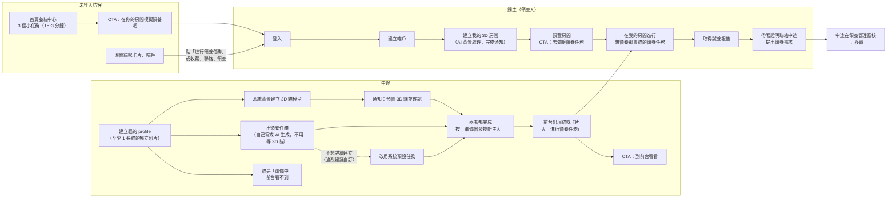
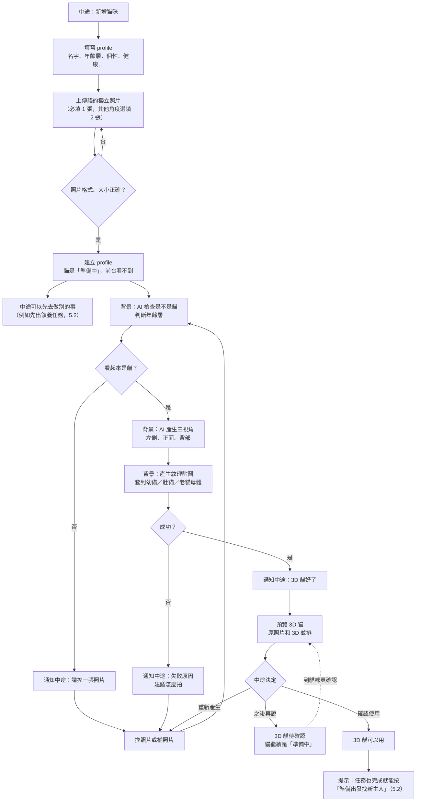
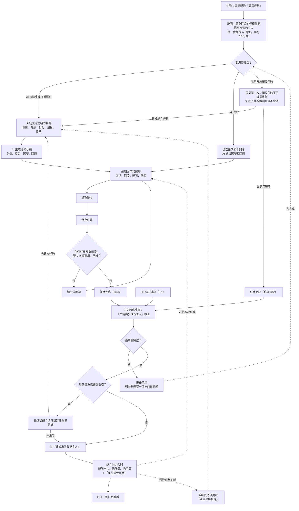
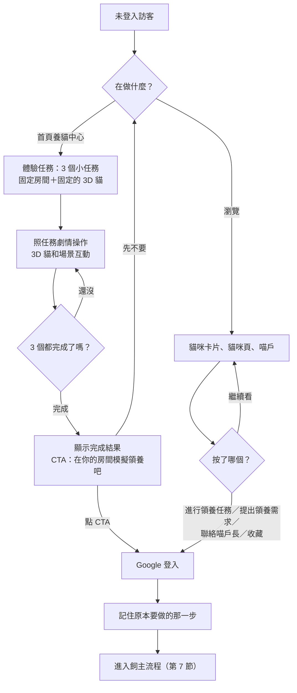
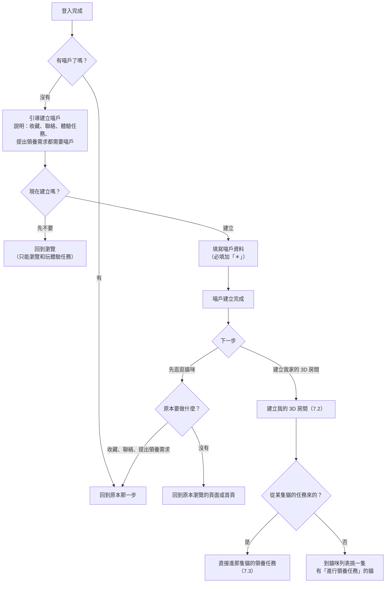
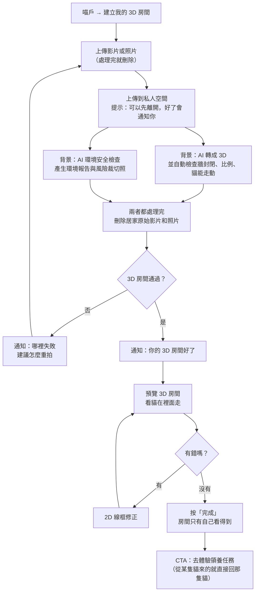
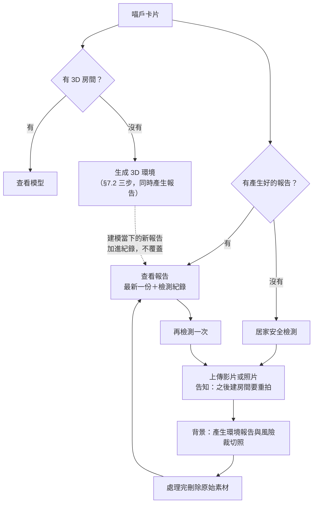
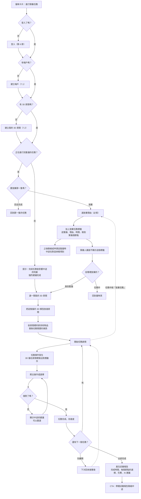
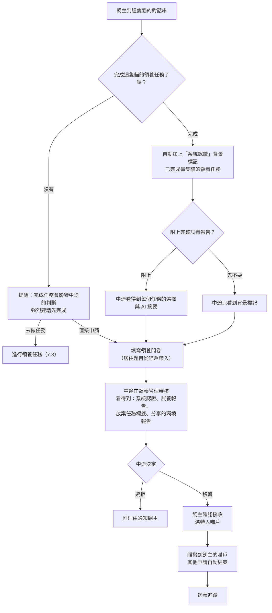

# 領養任務目標流程規格（Target User Flows）

| 項目 | 內容 |
|---|---|
| 文件版本 | v0.7 草稿（2026/11/06） |
| 涵蓋模組 | readiness（M08 虛擬飼養）、household-cats（M02）、adoption（M09）、matching（M17 首頁） |
| 上層文件 | `01_系統需求規格書_SRS.md`；`docs/hq/04`（貓咪模型）、`docs/hq/05`（平面圖轉換）；決策 006、007、008 |
| 目的 | 定下產品最終要走通的使用者流程，作為之後拆 Issue 的依據 |

---

## 1. 產品目標（一句話）

想領養的飼主在**自己建的 3D 房間**裡，放入**想領養那隻貓的 3D 模型**；3D 貓配合**任務劇情**和場景互動。飼主完成任務後，拿**試養報告**去和中途對話。

## 2. 角色與能做的事

| 動作 | 未登入訪客 | 貓友（已登入、沒有喵戶） | 喵戶長（飼主／領養人） | 中途（認證中途） |
|---|---|---|---|---|
| 瀏覽貓咪卡片、貓咪頁、喵戶（只看得到已出發找新主人的貓） | 可以 | 可以 | 可以 | 可以 |
| 玩首頁「養貓中心」的體驗任務 | 可以 | 可以 | 可以 | 可以 |
| 收藏貓 | 要先登入 | 要先建立喵戶 | 可以 | 可以 |
| 聯絡喵戶長（私訊） | 要先登入 | 要先建立喵戶 | 可以 | 可以 |
| 建立 3D 房間 | 要先登入 | 要先建立喵戶 | 可以 | 可以 |
| 進行某隻貓的領養任務 | 要先登入 | 要先建立喵戶 | 可以（需先有 3D 房間） | 不能對自己的貓做 |
| 提出領養需求（領養問卷） | 要先登入 | 要先建立喵戶 | 可以 | 不能對自己的貓做 |
| 建立貓的 profile 與 3D 貓模型 | — | — | 可以 | 可以 |
| 為貓出領養任務 | — | — | — | 可以 |

- 「要先登入」：點了之後跳 Google 登入，登入後**回到原本要做的那一步**。
- 「要先建立喵戶」：跳到建立喵戶，建好後回到原本要做的那一步（見 §7.1）。也就是說，**貓友只能瀏覽和玩體驗任務**，其他動作都要先有喵戶。

## 3. 新名詞（確認後補進 GLOSSARY.md）

| 名詞 | 意思 |
|---|---|
| **3D 貓模型** | 由貓的照片生成、屬於那隻貓的 3D 模型（GLOSSARY「虛擬貓」的一種）＝共用母體（幼貓／壯貓／老貓體型）＋這隻貓的紋理貼圖 |
| **我的 3D 房間** | 喵戶長用自家影片或照片建立的 3D 室內空間，只有自己看得到（決策 007） |
| **領養任務** | 中途為某隻待領養貓出的任務劇情，或由系統依這隻貓的資料生成、中途確認。在領養人自己的 3D 房間裡進行；3 個節點：到家第一天、五年後、臨終前（#237） |
| **系統預設任務** | 中途不想詳細建立任務時改用的通用任務組，依年齡層（幼貓／壯貓／老貓）各一套，不針對這隻貓的個性 |
| **準備中的貓** | 已建立 profile、但中途還沒按「準備出發找新主人」的貓。**前台完全看不到**（貓咪卡片、貓咪頁、喵戶頁都不顯示），只有中途自己看得到 |
| **準備出發找新主人** | 中途讓貓在前台公開的動作。要 3D 貓已確認，且任務已完成（自訂任務或選用系統預設任務）才能按 |
| **試養報告** | 領養人完成某隻貓的領養任務後，系統產生的紀錄：完成時間、每個節點的選擇與結果、花費（公式計算）、AI 寫的建議。原本叫「任務證明」，2026/11/06 統一改名。在對話串顯示為「系統認證」背景標記，並可附上完整紀錄 |
| **放棄任務標籤** | 領養人中途放棄某隻貓的領養任務時，系統記下的標籤（含理由與時間）。**只有那隻貓的中途在對話串看得到**，領養人自己的畫面不顯示 |
| **養貓中心體驗任務** | 首頁「養貓中心」的 3 個小任務：1 個固定房間＋1 隻固定的 3D 貓，不用登入，1～3 分鐘玩完 |

## 4. 全貌

## 5. 中途

### 5.1 建立貓的 profile 時一起建立 3D 貓模型

**素材**（沿用 MeowHQ 貓咪模型流程，`docs/hq/04` §2.3、#110、#129）：

| 素材 | 必填 | 說明 |
|---|---|---|
| 貓的獨立照片 1 張 | 必填 | 畫面裡只有這隻貓；最好側拍、坐姿或站姿、拍到全身、背景單純。JPG／PNG／WebP，10 MB 內 |
| 其他角度照片 | 選填，最多 2 張 | 給 AI 當參考，讓看不到的花紋更準 |
| 影片 | 選填 | 用在 profile 和個性分析，不用來建 3D 貓 |
| 年齡層 | 必填 | 幼貓／壯貓／老貓，決定 3D 母體體型；AI 也會看照片判斷 |

**流程**
- profile 至少要有 1 張貓的獨立照片才能建立（現在照片是選填）。
- 建立後貓是「**準備中**」，前台完全看不到；要等中途按「準備出發找新主人」（5.2）才公開。
- 送出 profile 後，系統在背景依序跑：AI 檢查是不是貓、判斷年齡層 → AI 產生三視角（左側、正面、背部） → 產生紋理貼圖（約 3～6 分鐘） → 套到母體。中途不用等，可以先離開。
- 完成後通知中途：預覽 3D 貓，選「確認使用」或「重新產生」（可換照片）。也可以之後再到貓咪頁確認。
- 確認後提示：任務也完成，就能按「準備出發找新主人」（5.2）。

### 5.2 出領養任務與「準備出發找新主人」

- **不用等 3D 貓建好**：建立 profile 後就可以出任務。任務只描述劇情與要 3D 貓做的動作，3D 貓建好後去配合任務。
- **強烈建議自訂任務**：進入任務頁時先說明「為這隻貓量身打造的任務，最能幫你找到合適的主人；每一步都有 AI 幫忙，大約 10 分鐘就能完成」。
- 三種做法：
  1. **AI 協助生成**（預設推薦）：系統讀這隻貓的資料（個性標籤、健康標籤、日記、週報、影片分析）產生草稿，中途修改後確認。
  2. **自己寫**：從空白或範本開始，寫的時候 AI 也會建議選項和回饋。
  3. **先用系統預設任務**：不詳細建立，改用同年齡層的通用任務組。選這個時再提醒一次：預設任務不了解這隻貓的個性，領養人比較難判斷合不合適；之後隨時可以改成自訂任務。
- **編輯任務只改文字和選項，不用 3D 預覽**：劇情、時間、選項、每個選項的回饋，也可以調整難度（#58）。
- 每個任務要 3D 貓做的動作（例如跳上高處、抓門、吐毛球、躲起來）和需要的家具或物品類型，由系統依劇情帶入，中途不用設定。房間裡沒有時自動換成功能相近的（見 §7.3「替換規則」）。
- 中途按「儲存任務」，系統檢查每個任務都有劇情、至少 2 個選項、每個選項都有回饋，通過才算「任務完成」。選用系統預設任務也算任務完成。

**「準備出發找新主人」按鈕**
- 在中途的貓咪頁（管理畫面）上，顯示兩項檢查：**3D 貓已確認**、**任務完成**（自訂任務或系統預設任務）。
- 兩項都完成才能按；沒完成時按鈕停用，並列出還差哪一項、附上前往的連結。
- 用的是系統預設任務時，按下前最後提醒一次「改成自訂任務會更好」，可以選「先出發」或「去建立任務」。
- 按下後貓才在前台公開：**貓咪卡片、貓咪頁、喵戶頁都開始顯示這隻貓**，並有「進行領養任務」按鈕；畫面顯示 CTA「到前台看看」。
- 之後改任務或重新產生 3D 貓：改完、確認前，前台繼續用目前的版本，不會突然消失。已經開始的領養人繼續用開始時那一版（§10.1 #9）。
- 使用系統預設任務出發的貓，中途的貓咪頁持續顯示「建立專屬任務」的提示。

## 6. 未登入訪客

- 只能瀏覽貓咪卡片、貓咪頁、喵戶，以及玩首頁「養貓中心」的體驗任務。
- 體驗任務是 **3 個小任務**，用 **1 個固定房間模型**和 **1 隻固定的 3D 貓**，1～3 分鐘玩完。進度只存在瀏覽器，不用登入。
- 完成後顯示 CTA「在你的房間模擬領養吧」→ 登入 → 建立喵戶 → 建立我的 3D 房間。
- 要做下一步（收藏、聯絡喵戶長、提出領養需求、進行某隻貓的領養任務）都先登入，登入後回到原本那一步。

## 7. 飼主（想領養的人）

### 7.1 登入後建立喵戶

- 登入後如果還沒有喵戶，一律先引導建立喵戶，並說明：**收藏、聯絡喵戶長、體驗領養任務、提出領養需求都要先有喵戶**。
- 一般飼主的喵戶資料就是試養遊戲的玩家背景（2026/11/06，#233），以下都必填＊：住家型態、住家狀況（租屋時再問房東同不同意養貓）、同住的人（可選「自己住」）、家裡現有的寵物（可選「沒有」）、養貓經驗、每月可以花在貓身上的預算。
  - 每月預算只有喵戶長自己看得到（不跟著喵戶公開，`meow_household_budgets`，0025）；試養遊戲用它分析預算夠不夠、給建議。
  - 舊的喵戶不強迫補填；遊戲遇到沒填的欄位用範例資料補。
- 建立喵戶後給兩個下一步：「建立我家的 3D 房間」、「先逛逛貓咪」（文案見 §8）。
  - 從某隻貓的「進行領養任務」來的：建好房間後直接回到那隻貓的任務。
  - 原本要收藏、聯絡、提出領養需求的：「先逛逛貓咪」直接回到那一步並自動接著做。

### 7.2 建立我的 3D 房間

整個流程只有三步，飼主不用做任何選擇：

1. **上傳影片或照片，建立 3D 房間**：錄一段家裡的影片，或每間房拍 1～4 張照片（沿用後台已經做好的轉換）。
2. **同時做 AI 環境安全檢查**：背景轉 3D 的同時產生環境報告與風險裁切照；所有房間都會做，不另外詢問。
3. **處理完成後刪除原始素材**：3D 房間和環境報告都產出後，立即刪除居家原始影片和照片，只留 3D 房間、環境報告、風險裁切照（決策 007，不用改）。

細節：

- 上傳前告知一句：素材只用來建房間和做安全檢查，處理完就刪除。
- 背景處理包含自動檢查（牆是否封閉、比例合理、放一隻貓能不能走動）。飼主可以先離開，**成功後才通知**。
- 處理失敗（例如牆不封閉）時，原始素材**也一樣刪除**，通知哪裡失敗、建議怎麼重拍，飼主重新上傳一整組。
- 收到通知後預覽房間，有錯可以在 2D 線框上修正（修正只用 3D 結果，不需要原始素材）；按「完成」代表確認房間，之後才能開始領養任務。
- 依決策 007：**3D 房間只有自己看得到**；環境報告由領養人在對話串主動分享給中途。
- 完成後顯示 CTA「去體驗領養任務」。

#### 喵戶頁的兩顆按鈕

喵戶卡片上有「生成 3D 環境」（主要）和「居家安全檢測」（次要）兩顆按鈕，依狀態變成：

| 狀態 | 第一顆 | 第二顆 |
|---|---|---|
| 都還沒做 | 生成 3D 環境 | 居家安全檢測 |
| 3D 房間處理中 | 3D 房間處理中（停用） | 安全檢測處理中（停用）：建模同時在產生報告 |
| 單獨檢測處理中 | 生成 3D 環境 | 安全檢測處理中（停用） |
| 3D 房間已完成 | 查看模型 | 查看報告 |
| 只做過單獨檢測 | 生成 3D 環境 | 查看報告 |

- 有任何一份產生好的環境報告，第二顆就變「查看報告」。建立 3D 房間時的報告如果失敗，第二顆維持「居家安全檢測」。

#### 單獨做居家安全檢測

- 還沒建 3D 房間也可以按「居家安全檢測」，只做檢查、不建房間。
- 一樣是三步：上傳影片或照片 → AI 產生環境報告與風險裁切照 → 處理完刪除原始素材（失敗也刪，請飼主重拍）。
- 上傳前告知：這次只做安全檢查；之後要建 3D 房間，需要重新拍攝（原始檔已經刪了）。
- 之後再建 3D 房間時，建模當下也會產生一份新報告。**舊報告不覆蓋，兩份都留下**，變成檢測紀錄。

#### 查看報告與檢測紀錄

- 「查看報告」打開最新一份，下方列出過去的檢測紀錄：日期、來源（單獨檢測／建立 3D 房間時）、風險項目數量。
- 報告頁有「再檢測一次」，走單獨檢測的流程，產生的報告加進紀錄。
- 在對話串分享環境報告時，預設分享最新一份，也可以改選其他紀錄；每一份都要領養人主動分享，中途才看得到（決策 007）。

### 7.3 進行領養任務，取得試養報告

- 從貓咪卡片或貓咪頁按「進行領養任務」開始；需要已登入、有喵戶、有 3D 房間（缺哪一步就引導補哪一步，做完回來）。
- 開始前提示：**完成任務不是提出領養需求的必要條件，但會影響中途對領養的判斷，強烈建議完成**。
- 開始時選要用哪一間房；把這隻貓的 3D 模型放進去，依任務劇情一個一個進行。3D 貓會配合劇情和場景互動（例如凌晨在走廊衝刺、跳上高處、躲起來）。
- 選錯會顯示中途的建議，可以重選；進度存在帳號，可以分次完成。
- 劇情分成 **3 個節點**（渝茜 #237，2026/11/06 確認）：
  1. **到家第一天**：幼貓模型。開始前填每月預算，採買飼料、貓砂和基本用品（超過預算紅字提醒），並在 3D 房間擺好飼料碗和貓砂盆。
  2. **五年後**：成貓模型。唯一一次居家意外固定在這裡，從環境報告找出的危險裡挑一件。
  3. **臨終前**：成貓模型，選擇安寧照護的方式。
- 玩家背景直接讀喵戶的住家資料（住家型態、住家狀況、同住的人、現有寵物），不再另外問；遊戲開始前由任務 API 一次給齊初始資料（貓、中途的送養條件與交接物品、房間與家具、居家危險、生活用品），見 #233。
- 同時只能進行一隻貓的領養任務（readiness 決策）。
- 全部完成後產生**試養報告**。

**替換規則**：任務需要的家具或物品，房間裡沒有時，換成功能相近、這間房裡有的東西，並在任務說明裡用實際的物品名稱。

| 任務需要 | 沒有時改用（依序找） |
|---|---|
| 沙發（跳上去、窩著） | 床 → 櫃子 → 椅子 |
| 高處（跳上去） | 櫃子 → 書桌 → 電視櫃 → 流理台 |
| 可以躲的地方 | 床底 → 衣櫃旁 → 沙發後 |
| 桌上的小物品（水杯等，撥下桌） | 這間房模型桌上的任何小物品 |
| 門（抓門） | 這間房的任一扇門 |
| 都找不到 | 改成文字情境，不播 3D 動作 |

**放棄任務**
- 任務中隨時可以按「放棄任務」；開始別隻貓的任務時，也要先放棄目前這隻。
- 放棄時**一定要選理由**（可複選，「其他」要填寫）：時間不夠、覺得自己還沒準備好、覺得不適合這隻貓、想先試別隻貓、任務太難、其他。
- 放棄後系統替領養人加上「**放棄任務標籤**」（這隻貓、理由、放棄時間、做到第幾個節點）：
  - **領養人自己的前台畫面不顯示**。
  - 領養人之後再聯絡這隻貓的中途或提出領養申請時，**中途在對話串看得到**這個標籤。
  - 之後重新做完任務，標籤仍保留，和試養報告一起顯示，讓中途看到完整經過。

### 7.4 帶著試養報告和中途對話

- 試養報告出現在這隻貓的對話串：飼主身上自動加上「系統認證」背景標記（例如「已完成這隻貓的領養任務」），飼主可以按「附上試養報告」把完整紀錄分享給中途。
- 沒完成任務也可以提出領養需求，但送出問卷前再提醒一次「完成任務會影響中途的判斷」。
- 中途在對話串看得到：系統認證標記、附上的試養報告、放棄任務標籤（如果有）、分享的環境報告（如果有）。
- 之後接現有的領養流程：填領養問卷 → 中途在領養管理審核 → 婉拒或移轉。

## 8. 主要文案（UX writing）

| 位置 | 文案 | 說明 |
|---|---|---|
| 首頁養貓中心完成後 CTA | 在你的房間模擬領養吧 | 依原需求 |
| 貓咪卡片、貓咪頁按鈕 | 進行領養任務 | 依原需求 |
| 引導建立喵戶 | 先建立你的喵戶。收藏貓咪、聯絡喵戶長、體驗領養任務和提出領養需求，都會用到它。 | |
| 喵戶建好後的主要按鈕 | 建立我家的 3D 房間 | 副標：讓想領養的貓在你家走一圈，體驗完整的領養任務。取代「建立 3D 模型以體驗完整產品」，避免和 3D 貓模型混淆 |
| 喵戶建好後的次要按鈕 | 先逛逛貓咪 | |
| 上傳前 | 我們會用影片或照片建立你家的 3D 房間，同時檢查家裡對貓安不安全。處理完就會刪除原始檔，只留房間和安全報告。 | 業務規則要求的隱私聲明 |
| 上傳後 | 正在建立你家的 3D 房間和安全報告。你可以先離開，好了會通知你。 | |
| 房間完成通知 | 你家的 3D 房間和安全報告好了，來看看貓在裡面走的樣子。 | |
| 處理失敗 | 這次沒有建好房間，原始檔已經刪除。{失敗原因}，重新拍一次就可以了。 | 按鈕：重新拍攝 |
| 喵戶卡片按鈕 | 生成 3D 環境／查看模型；居家安全檢測／查看報告 | 依 §7.2 狀態表切換；處理中顯示「3D 房間處理中」「安全檢測處理中」並停用；建模時兩顆一起處理中 |
| 單獨檢測上傳前 | 這次只檢查家裡對貓安不安全，處理完就會刪除原始檔。之後想建立 3D 房間，需要重新拍攝。 | |
| 單獨檢測完成通知 | 你家的安全報告好了，看看有哪些地方要注意。 | |
| 報告頁按鈕 | 再檢測一次 | 新報告加進檢測紀錄 |
| 檢測紀錄來源 | 單獨檢測／建立 3D 房間時 | |
| 房間完成後 CTA | 去體驗領養任務 | |
| 開始領養任務前 | 完成任務不是申請的必要條件，但中途會參考你的完成情況，強烈建議做完。 | |
| 放棄任務 | 要放棄{貓名}的領養任務嗎？告訴我們原因，幫助我們把任務做得更好。 | 理由必選 |
| 任務完成後 CTA | 帶著試養報告聯絡中途 | |
| 中途：3D 貓完成通知 | {貓名}的 3D 模型做好了，看看像不像牠。 | 按鈕：確認使用／重新產生 |
| 中途：3D 貓確認後 | {貓名}的 3D 模型準備好了。任務也完成，就能出發找新主人。 | |
| 中途：任務頁開頭 | 為{貓名}量身打造任務，最能幫牠找到合適的主人。每一步都有 AI 幫忙，大約 10 分鐘就能完成。 | 按鈕：AI 幫我生成（主要）／自己寫／先用系統預設任務 |
| 中途：選系統預設任務時 | 預設任務不了解{貓名}的個性，想領養的人比較難判斷合不合適。之後隨時可以改成專屬任務。 | 按鈕：還是用預設／改成建立任務 |
| 中途：用預設任務出發前 | {貓名}目前用的是系統預設任務。花 10 分鐘建立專屬任務，會更容易遇到合適的主人。 | 按鈕：先出發／去建立任務 |
| 中途：預設任務的貓咪頁提示 | 建立專屬任務 | |
| 中途：貓咪頁按鈕 | 準備出發找新主人 | 3D 貓確認、任務資料完成才能按；停用時列出還差：3D 模型還沒確認／任務還沒完成 |
| 中途：按下後 | {貓名}出發找新主人了！大家現在看得到牠，也可以進行牠的領養任務。 | 按鈕：到前台看看 |

## 9. 和現在的差距

| 項目 | 現在（main，2026/11/03） | 目標 |
|---|---|---|
| 貓的照片 | 選填 | 至少 1 張貓的獨立照片 |
| 貓在前台出現的時間 | 建立 profile 就是待領養、前台馬上看得到（`meow_cats.status` 預設 `adoptable`） | 「準備中」前台看不到，中途按「準備出發找新主人」才公開 |
| 3D 貓模型 | 只有 MeowHQ 管理員在後台做，紋理貼圖要在 Tina 電腦跑（paint_worker） | 中途建立 profile 後系統背景自動產生，中途確認 |
| 領養任務 | 只有首頁寫死的示意（橘子第 3 天）；`virtual_sessions`、`virtual_tasks` 還沒建 | 中途自寫或 AI 生成、按「準備出發找新主人」開放、綁 3D 動作與家具替換；進度存帳號 |
| 「進行領養任務」按鈕 | 沒有 | 貓咪卡片與貓咪頁都有（條件見 5.2） |
| 首頁養貓中心 | 2D 任務清單，固定第 3 天 | 固定 3D 房間＋固定 3D 貓的 3 個小任務，完成後 CTA |
| 我的 3D 房間 | 前台「生成 3D 環境」是製作中頁；轉換只在 MeowHQ | 前台喵戶長自己建立，背景處理、完成通知 |
| 環境報告 | 前台「居家安全檢測」是製作中頁 | 建立 3D 房間時一律同時產生；也能單獨檢測；多份報告留成檢測紀錄 |
| 喵戶卡片按鈕 | 固定「生成 3D 環境」「居家安全檢測」 | 做完後變「查看模型」「查看報告」 |
| 3D 貓和場景互動 | 後台虛擬體驗（#150）能點地板走路、被牆和家具擋 | 跳上家具、配合劇情的動作 |
| 試養報告、放棄任務標籤 | 沒有（GLOSSARY 已定義「系統認證」背景標記） | 對話串顯示給中途 |
| 收藏、聯絡、提出領養需求 | 登入就能做，沒有喵戶也能填問卷 | 一定要先有喵戶 |
| 登入後引導 | 沒有 | 引導建立喵戶、回到原本那一步 |

## 10. 已確認與待確認

### 10.1 已確認（2026/11/03）

| # | 題目 | 決定 |
|---|---|---|
| 1 | 試養報告是否必要 | 不必要，但強烈建議完成，並告知會影響領養判斷 |
| 2 | 首頁體驗任務 | 3 個小任務，1～3 分鐘玩完 |
| 3 | 居家原始影像何時刪除 | 3D 房間和環境報告都處理完就刪（失敗也刪），和決策 007 一致；環境檢查一律做、不另外詢問（11/04 簡化） |
| 4 | 3D 貓運算搬離 Tina 電腦 | 先把流程完善，搬移時程之後再定 |
| 5 | 房間缺任務要的家具或物品 | 換成功能相近的家具或物品（§7.3 替換規則） |
| 6 | 收藏、聯絡喵戶長 | 也要先建立喵戶 |
| 7 | 喵戶建好後的按鈕文案 | 改成「建立我家的 3D 房間」（§8） |
| 8 | 領養任務和 3D 貓的順序 | 任務可以先出，3D 貓建好後配合任務 |
| 9 | 中途改了任務，正在做的人怎麼辦 | 繼續用開始時那一版，試養報告也照那版；新開始的人用新版 |
| 10 | 編輯任務要不要 3D 預覽 | 不用，只改文字和選項 |
| 11 | 「準備出發找新主人」之前 | 整張貓咪卡片都不出現（貓咪頁、喵戶頁也不顯示）；3D 貓確認、任務完成才能按 |
| 12 | 中途不想詳細建立任務 | 可以用系統預設任務，但要強烈建議自訂，並告知全程有 AI 輔助、不會花太多時間 |
| 13 | 已經公開的貓 | 都是測試資料，不另外處理；「準備中」用新的貓狀態 `preparing`（0017） |
| 14 | 任務證明的名稱、劇情長度（11/06） | 統一叫「試養報告」；劇情照渝茜 #237 的 3 個節點，不再用 7 天 |

### 10.2 待確認

1. **前台還要不要接受平面圖**：平面圖做不了環境檢查，本稿先拿掉，只收影片或照片。若要保留，只能當影片或照片的補充，幫 AI 抓格局。
2. **放棄任務標籤要不要在隱私權政策（`docs/spec/08`）寫明**：領養人畫面看不到，但中途看得到。建議在政策裡寫一句「放棄任務的紀錄會提供給該貓的中途參考」。
3. **只有影片、沒有照片的貓**：要不要從影片截一張畫面當 3D 貓的照片？本稿預設不截，要求上傳 1 張照片。
4. **系統預設任務由誰維護**：本稿預設由 MeowHQ 管理員依年齡層各維護一套，內容待和渝茜一起定。

## 11. 資料（`supabase/migrations/0017_meow_adoption_tasks.sql`）

| 規格 | 資料庫 |
|---|---|
| 準備中、準備出發找新主人（§5.2） | `meow_cats.status` 加 `preparing`；準備中的貓只有喵戶長讀得到；`meow_publish_cat()` 檢查 3D 貓已確認、任務已存才改成待領養；畫面用 `meow_cat_publish_check()` |
| 中途的 3D 貓（§5.1） | `meow_cat_models.cat_id` 綁前台的貓；中途照片放 `meow-cat-model-photos/member/<自己的 id>/`；`meow_confirm_cat_model()`；出發後登入的人讀得到 |
| 領養任務、系統預設任務（§5.2） | `meow_task_templates`（依年齡層，MeowHQ 維護）、`meow_cat_task_sets`（草稿）、`meow_cat_task_versions`（存了就不改）；`meow_save_cat_tasks()` 檢查劇情、2～6 個選項、回饋 |
| 我的 3D 房間（§7.2） | `meow_room_models.owner_household_id`（0015 已有）＋ `completed_at`（按「完成」，任務開始前檢查）、`raw_deleted_at`（伺服器刪原始檔後寫入）；後台看不到會員的房間；影片放 Azure `homes/<喵戶>/videos/…`（2026-11-07 起，#273）、成果放私有 bucket `meow-home-scenes`；`meow_finish_home_room()` 呼叫時 `p_env_check` 傳 `null`。`env_check` 欄位 11/04 簡化後不再使用（0017 已執行，先保留，之後的 migration 再移除） |
| 環境報告（§7.2、決策 007） | `meow_env_reports`、`meow_env_report_shares`、`meow_env_report_advice`；私有 bucket `meow-home-risk-crops`；`meow_share_env_report()`。單獨檢測的報告 `room_model_id` 為 `null`（0017 已允許），建立 3D 房間時的報告填房間 id；同一個喵戶可以有多份，依 `created_at` 排成檢測紀錄，不用改資料庫 |
| 進行任務、試養報告（§7.3、§7.4；資料庫函式仍沿用 `task_proof` 舊名） | `meow_task_runs`（同時只能一筆進行中）；`meow_start_task_run()`、`meow_complete_task_run()`、`meow_share_task_proof()`、`meow_thread_task_status()` |
| 放棄任務標籤（§7.3） | `meow_task_abandons`：領養人自己讀不到，只有這隻貓的中途讀得到；`meow_abandon_task_run()` 理由必選 |
| 收藏、私訊、問卷要有喵戶（§2） | `meow_cat_favorites`、`meow_adoption_responses` 的新增 policy 與 `meow_open_thread()` 檢查 `meow_has_household()` |

- 過渡期：新增貓仍可直接是待領養（現在 `/onboarding` 送 `adoptable`）。「準備出發找新主人」畫面做好、`/onboarding` 改送 `preparing` 後，再開一個小 migration 限制新增只能是 `preparing`。
- AI 摘要（`meow_task_runs.summary`）、3D 房間與環境報告的處理結果由伺服器（service role）寫入，會員不能自己改。

## 12. 變更紀錄

| 日期 | 發起人 × 工具 | 變更 | PR |
|---|---|---|---|
| 2026-11-03 | 子哲 × Claude Code | 建立目標流程草稿 v0.1 | — |
| 2026-11-03 | 子哲 × Claude Code | v0.2：3D 貓素材依 MeowHQ 流程、任務不用等 3D 貓、房間背景處理與環境檢查詢問、放棄任務標籤、家具替換規則、收藏與聯絡也要喵戶、文案表 | — |
| 2026-11-03 | 子哲 × Claude Code | v0.3：編輯任務不做 3D 預覽、新增「準備出發找新主人」按鈕、任務改版採用開始時那版 | — |
| 2026-11-03 | 子哲 × Claude Code | v0.4：出發前整張貓咪卡片不出現、新增「準備中」與系統預設任務、強烈建議自訂任務的文案 | — |
| 2026-11-03 | 子哲 × Claude Code | v0.5：已公開的貓不另外處理、新增 §11 資料對照（0017） | — |
| 2026-11-04 | 子哲 × Claude Code | v0.6：建立 3D 房間簡化成三步（上傳→同時建房間與環境檢查→處理完刪原始檔）；拿掉環境檢查的詢問、再提醒與之後補做按鈕；刪除時間點回到決策 007；前台先不收平面圖；喵戶卡片兩顆按鈕依狀態變「查看模型」「查看報告」；可單獨做居家安全檢測，多份報告留成檢測紀錄 | — |
| 2026-11-06 | 子哲 × Claude Code | v0.7：「任務證明」統一改名「試養報告」（內容加花費與 AI 建議）；任務劇情改成渝茜 #237 的 3 個節點（到家第一天、五年後、臨終前），拿掉暫定 7 天；玩家背景讀喵戶住家資料，遊戲開始前由任務 API 給齊初始資料（#233） | — |
| 2026-11-06 | 子哲 × Claude Code | v0.7：§7.1 一般飼主的喵戶欄位改必填，新增房東、養貓經驗、每月預算（0025，只有本人看得到）（#233） | — |
