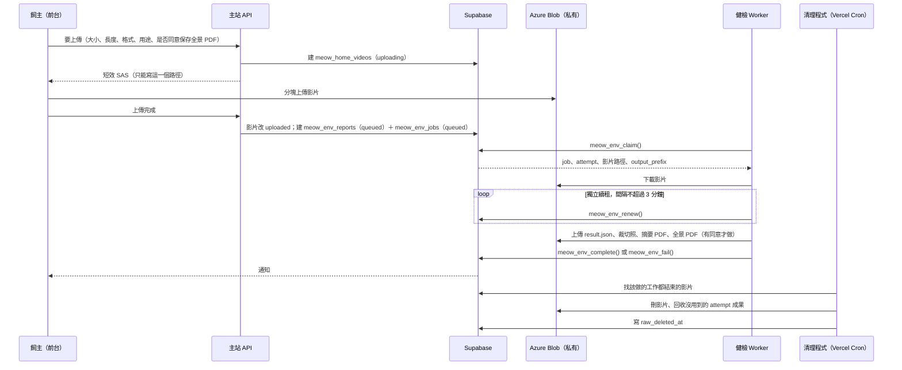

# 居家環境健檢 Worker 契約（主站 × WelfareLens）

| 項目 | 內容 |
|---|---|
| 文件版本 | v0.3（2026/11/06）：v0.2 依 Jerry 對 §9 的回覆修訂；v0.3 加入本人專用全景 PDF（#240 修訂）。§10 剩 180 秒實測待定 |
| 對應 Issue | #241（整合）、#240（PDF 保存）、#242（影片清理）、#243（上傳限制）；上層 #62、#161 |
| 角色 | 主站（子哲＋Claude Code）：migration、RPC、API、上傳、清理程式。Worker（Jerry）：WelfareLens 領件、分析、上傳成果、回寫 |
| 相關決策 | 決策 006（大檔案放 Azure）、決策 007（居家影像產出後刪除、報告預設只有本人看得到；2026-11-06 補充：本人專用全景 PDF、失敗影片最多留 7 天） |

這份文件只定介面：資料表欄位、RPC 的參數與錯誤、檔案路徑、狀態怎麼轉。雙方照這份各自開工；欄位或名稱要改，先改這份再改程式。

---

## 1. 全貌



- 建立 3D 房間（影片用途 `room`）：同一支影片排 `meow_room_jobs`（3D）和 `meow_env_jobs`（健檢）。
- 單獨居家安全檢測（影片用途 `safety`）：只排 `meow_env_jobs`。
- **Worker 不刪影片**，只回報結果；影片一律由清理程式刪（#242）。

## 2. 限制（#243）

| 項目 | 值 |
|---|---|
| 格式 | mp4、mov（`video/mp4`、`video/quicktime`） |
| 長度 | 最長 180 秒，只收一段 |
| 大小 | 最大 300 MB |
| 誰檢查 | 前台上傳前（讀影片長度與大小）、主站 API 簽 SAS 前、Worker 下載後各檢查一次；超過就失敗、不重試 |
| 取樣 | 第一版每支影片 8 張影格（Worker 內部參數，不進資料庫） |

## 3. 資料表

### 3.1 `meow_home_videos`（新增，只有 service role 讀寫）

每支居家影片一筆，清理程式靠它判斷「這支影片要等哪些工作」。

| 欄位 | 型別 | 說明 |
|---|---|---|
| `id` | uuid PK | 也是上傳 id，用在路徑裡 |
| `household_id` | uuid → `meow_households.id`，on delete cascade | |
| `path` | text unique | `homes/<喵戶>/videos/<id>.<mp4/mov>` |
| `purpose` | text | `room`（要等 3D＋健檢）／`safety`（只等健檢） |
| `status` | text | `uploading` → `uploaded`；上傳 24 小時沒完成視為孤兒 |
| `size_bytes`、`duration_s` | bigint、numeric | 主站簽 SAS 前記錄的值 |
| `uploaded_at`、`raw_deleted_at` | timestamptz | `raw_deleted_at` 由清理程式寫 |

`meow_room_models.raw_deleted_at`（0017）保留，改成由清理程式在刪影片時一起寫，前台照舊讀它。

### 3.2 `meow_env_jobs`（新增，只有 service role 讀寫）

| 欄位 | 型別 | 說明 |
|---|---|---|
| `id` | uuid PK | |
| `report_id` | uuid → `meow_env_reports.id`，on delete set null | 一份報告同時只能有一筆 queued／running |
| `household_id` | uuid → `meow_households.id` | 來源喵戶；領件時驗證影片路徑屬於它 |
| `video_id` | uuid → `meow_home_videos.id` | |
| `want_full_pdf` | boolean | 建工作時從報告的 `full_pdf_consent_at` 帶入；領件時回傳給 Worker |
| `status` | text | `queued`／`running`／`done`／`failed`／`canceled` |
| `attempt` | int，預設 0 | 每次領件 +1；續租、回寫時必須相同 |
| `max_attempts` | int，預設 3 | **總共**最多 3 個 attempt（含第一次） |
| `lease_until` | timestamptz | 領件與續租時設成「現在＋10 分鐘」 |
| `worker_id` | text | Worker 自報的名稱（機器名＋程序 id） |
| `step` | text | 目前在做什麼，給後台看 |
| `error_code` | text | 最後一次失敗代碼，見 §4.6 |
| `error_detail` | text | 給後台看的技術細節（不含金鑰、不含個資），500 字內 |
| `retryable` | boolean | 最後一次失敗是否可以重試 |
| `result_json_path`、`result_pdf_path` | text | complete 成功時的路徑，給冪等確認用 |
| `queued_at`、`started_at`、`finished_at` | timestamptz | |

- RLS：只開給 MeowHQ（`virtual_assets` 模組）讀；會員看不到工作表，進度看報告的 `status`。
- **取消**：飼主在處理中刪掉報告或刪掉喵戶時，觸發器把 queued／running 的工作改 `canceled`（`report_id` 變 null，工作列保留給清理程式判斷）。
- 一筆工作「結束」＝`done`、`canceled`，或 `failed` 且不再重試（`attempt >= max_attempts` 或 `retryable = false`）。清理程式用這個判斷。

### 3.3 `meow_env_reports`（0017 已有，新增欄位）

| 欄位 | 說明 |
|---|---|
| `status` | `queued` → `running` → `ready`／`failed`（只由 RPC 改） |
| `summary`、`items`、`ready_at`、`error` | 0017 已有。`items` 格式見 §6.1；`error` 是給飼主看的中文原因，由主站依 `error_code` 對照產生 |
| `warnings`（新） | jsonb 陣列，畫質等提醒，見 §6.2；有提醒不代表失敗 |
| `json_path`（新） | `result.json` 的 Azure 路徑，格式見 §6.3 |
| `pdf_path`（新） | **摘要 PDF**：只含風險裁切照與文字，不放全景圖。必填；分享給中途時能看的是這份 |
| `full_pdf_path`（新） | **全景 PDF**：真實居家視角 Before、AI 模擬 After、局部特寫、照護建議。**只有本人看得到**，分享報告不會授權給中途；沒同意就是 null（§6.4） |
| `full_pdf_consent_at`（新） | 本人同意保存全景 PDF 的時間；null 代表沒同意，Worker 不產生全景 PDF（§6.5） |
| `attempt`（新） | 寫入成果的那次 attempt，清理程式用它分辨哪些成果要留 |

## 4. RPC（都是 `security definer`，只開給 service role）

Worker 用 service role key 呼叫 PostgREST：`POST /rest/v1/rpc/<函式>`。

### 4.1 `meow_env_claim(p_worker text) returns jsonb`

領最早的一筆工作，沒有就回傳 `null`。

- 可以領的：`status = 'queued'`，或 `status = 'running'` 但 `lease_until < now()`（上一個 Worker 當掉）。
- 用 `for update skip locked` 一次只讓一個 Worker 拿到。
- 領到時：`attempt + 1`、`status = 'running'`、`lease_until = now() + 10 分鐘`、`worker_id`、`started_at`；報告改 `running`。
- 租約過期而且 `attempt >= max_attempts` 的工作不會再被領，直接標 `failed`（`error_code = 'lease_expired'`，`retryable = false`），報告改 `failed` 並通知。
- 領件前驗證影片 `path` 開頭是 `homes/<household_id>/videos/`、影片是 `uploaded` 且還沒刪，不符就標 `failed`（`error_code = 'source_invalid'`）、不交給 Worker。

回傳：

```json
{ "job_id": "uuid", "attempt": 2, "report_id": "uuid", "household_id": "uuid",
  "video_path": "homes/<喵戶>/videos/<影片 id>.mp4",
  "output_prefix": "homes/<喵戶>/reports/<報告>/a2/",
  "want_full_pdf": true,
  "lease_until": "2026-11-06T10:10:00Z" }
```

`output_prefix` 由主站給，Worker 不自己組路徑。

### 4.2 `meow_env_renew(p_job uuid, p_attempt int, p_step text) returns timestamptz`

續租：`lease_until = now() + 10 分鐘`，順便更新 `step`，回傳新的到期時間。

- Worker 用獨立的計時器續租，間隔不超過 3 分鐘，不綁在分析步驟上（某一步卡住時才不會誤判為當掉）。
- **租約已過期就不能續**：即使還沒有別的 Worker 接手，也回 `env_lease_expired`，Worker 必須放棄這次 attempt。

### 4.3 `meow_env_complete(p_job uuid, p_attempt int, p_summary text, p_items jsonb, p_warnings jsonb, p_json_path text, p_pdf_path text, p_full_pdf_path text default null) returns text`

一個 transaction 完成，回傳 `'done'` 或 `'already_done'`：

- 工作改 `done`、`finished_at`，記下 `result_json_path`、`result_pdf_path`。
- 報告寫入 `summary`、`items`、`warnings`、`json_path`、`pdf_path`、`full_pdf_path`、`attempt`，改 `ready`、`ready_at`。
- 檢查 §6 的格式、所有路徑都在這次的 `output_prefix` 底下、`p_pdf_path` 不能是空的，不符就整筆不寫（`env_result_invalid`）。
- `want_full_pdf = true` 時 `p_full_pdf_path` 必填；`false` 時必須是 null（沒同意就不能存全景圖）。
- 通知飼主（§7）。
- **成果檔要先上傳完，才能呼叫這支**；呼叫成功之前，報告看不到任何成果。
- 必要的分析、`result.json`、PDF（含有同意時的全景 PDF）或上傳任何一項失敗，都不能呼叫 complete，改呼叫 fail。
- **冪等**：同一個 job、同一個 attempt 已經 `done`，而且 `p_json_path`、`p_pdf_path`、`p_full_pdf_path` 都跟上次相同，回傳 `'already_done'`、不重寫、不重發通知。Worker 沒收到回應時可以安全重送。路徑不同則回 `env_job_not_running`。
- 檢查順序：先看冪等，再看租約；租約已過期（不論有沒有人接手）回 `env_lease_expired`。

### 4.4 `meow_env_fail(p_job uuid, p_attempt int, p_code text, p_detail text, p_retryable boolean) returns text`

- `p_code` 必須是 §4.6 的代碼之一，否則回 `env_result_invalid`。
- `p_retryable = true`、代碼屬於可重試類別，而且 `attempt < max_attempts`：工作改回 `queued`（下一次領件 attempt +1），回傳 `'requeued'`。
- 其他：工作改 `failed`、報告改 `failed`，回傳 `'failed'`；通知內容依代碼類別（§7）。
- **冪等**：同一個 attempt 已經回寫過 fail，再送一次回傳上次的結果（`'requeued'` 或 `'failed'`），不重發通知。
- 租約已過期也回 `env_lease_expired`（這時工作會在下次領件時由主站處理）。

### 4.5 RPC 錯誤

| 錯誤代碼 | 什麼時候 | Worker 該做什麼 |
|---|---|---|
| `env_job_not_found` | 工作不存在 | 停止，不再上傳或回寫 |
| `env_attempt_stale` | `p_attempt` 不是目前這次（已被別人接手） | 同上 |
| `env_lease_expired` | 租約已過期 | 同上 |
| `env_job_canceled` | 飼主已刪除報告或喵戶 | 同上 |
| `env_job_not_running` | 工作已經結束、被改回 queued，或 complete 的路徑跟上次不同 | 同上 |
| `env_result_invalid` | §6 格式、路徑或錯誤代碼不符 | 不要原樣重送；修不好就 fail（`result_invalid`，不可重試） |

收到前五種，已上傳的成果檔留在原地，由清理程式回收（§8）。

### 4.6 失敗代碼

| 類別 | 代碼 | 可重試 | 飼主看到 |
|---|---|---|---|
| 暫時性 | `network`、`rate_limited`、`service_unavailable`、`timeout` | 是 | 還在處理中（重試用完才通知「暫時無法完成」） |
| 影片 | `video_format`、`video_too_long`、`video_too_large`、`video_unreadable`、`video_not_indoor` | 否 | 請照拍攝須知重拍 |
| 來源 | `source_invalid`（路徑不對、檔案不存在、已被刪） | 否 | 請重新上傳 |
| 系統 | `config_error`（部署設定）、`permission_denied`（儲存或資料庫權限）、`result_invalid`（確定性的成果驗證錯誤）、`lease_expired` | 否 | 我們這邊出了問題，修好會通知你，**不要求重拍** |

- 系統類別失敗會通知 MeowHQ；修好後由 MeowHQ 對同一支影片重新排一筆新工作（attempt 從 0 開始），影片在這段期間依 §8 的 7 天上限保留。
- 一般畫質問題（偏暗、晃動、部分角落沒拍到）不算失敗，寫進 `warnings`（§6.2）。

## 5. Azure 路徑與權限（私有容器，決策 006）

| 用途 | 路徑 | 誰寫 | 誰刪 |
|---|---|---|---|
| 居家影片 | `homes/<喵戶>/videos/<影片 id>.<mp4/mov>` | 前台（主站簽的寫入 SAS） | 清理程式 |
| 一次 attempt 的成果 | `homes/<喵戶>/reports/<報告>/a<attempt>/` | Worker | 清理程式（沒被報告採用的 attempt） |
| 　分析結果 | `…/a<n>/result.json` | Worker | 跟報告一起刪 |
| 　風險裁切照 | `…/a<n>/crops/<item key>.jpg` | Worker | 跟報告一起刪 |
| 　摘要 PDF | `…/a<n>/report.pdf` | Worker | 跟報告一起刪 |
| 　全景 PDF（本人專用） | `…/a<n>/report_full.pdf` | Worker（有同意才做） | 跟報告一起刪；本人撤回同意時立即刪 |

- **Worker 用 Managed Identity**：獨立 CPU VM 開系統指派的 Managed Identity，只授權到單一容器（`Storage Blob Data Contributor`，範圍是容器而不是整個儲存帳戶）。建議再加 ABAC 條件：影片前綴只能讀、只能在 `homes/*/reports/*` 寫入、不能刪除。不用儲存帳戶金鑰，主站也不另外簽 SAS 給 Worker。
- 前台只拿主站簽的短效 SAS（寫入 15 分鐘、讀取 10 分鐘）。
- 前台看報告、摘要 PDF、裁切照：主站 API 檢查權限（本人，或報告已分享給這位中途）後簽讀取 SAS。資料庫只存路徑。
- **全景 PDF 只簽給本人**：API 只認報告所屬喵戶的成員，報告分享給中途也不簽；MeowHQ 後台不提供下載。

測試與正式環境：

| | 測試 | 正式 |
|---|---|---|
| 儲存帳戶 | `meowhomedia` | `meowhomedia` |
| 容器 | `media-dev` | `media` |
| 端點 | `https://meowhomedia.blob.core.windows.net/media-dev` | `https://meowhomedia.blob.core.windows.net/media` |
| Supabase | 目前測試與正式共用同一個專案（決策 005） | 同左 |

- 因為 Supabase 共用，整合測試時：RPC 行為先用主站的 PGlite 測試驗證（競爭領件、租約到期、舊 attempt、冪等）；串真實 Supabase 時只用專用的測試喵戶，影片放 `media-dev`。
- Managed Identity 由子哲在 Azure 入口網站設定角色指派；測試 VM 先只授權 `media-dev`，驗收後再加 `media`。

## 6. 成果格式

### 6.1 `items`（報告欄位，第一版固定五欄）

```json
[{ "key": "window", "label": "窗戶沒有紗窗", "level": "high",
   "note": "貓可能從窗戶跳出或摔落。開窗前先裝好紗窗或防墜網。",
   "crop_path": "homes/<喵戶>/reports/<報告>/a2/crops/window.jpg" }]
```

- `key`：同一份報告內不重複，英數與底線，60 字內。
- `label`：繁體中文，20 字內。`level`：`high`／`medium`／`low`。`note`：繁體中文，200 字內，不給診斷或用藥建議。
- `crop_path`：**可以省略**（不放這個欄位，或給 `null`）；有的話必須在這次 `output_prefix` 底下，而且是裁到只剩風險物品的照片（決策 007）。
- 最多 30 項；`summary` 2000 字內。
- 不接受五欄以外的欄位；信心分數、出現時間點等放在 `result.json`。

### 6.2 `warnings`

```json
[{ "code": "low_light", "message": "畫面偏暗，部分角落可能沒有判讀到。" }]
```

- `code`：英數與底線，40 字內；`message`：繁體中文，100 字內。最多 10 項，沒有就給 `[]`。

### 6.3 `result.json`

完整分析結果，給後台查問題與之後重算用；前台不直接讀。

```json
{
  "schema": "meow_env_result/1",
  "job_id": "uuid", "report_id": "uuid", "attempt": 2,
  "worker": { "id": "vm-01:4242", "version": "welfarelens 0.4.0" },
  "model": { "name": "…", "version": "…" },
  "video": { "duration_s": 111.2, "frames": 8 },
  "summary": "…",
  "items": [{ "key": "window", "label": "…", "level": "high", "note": "…",
              "crop_path": "…/crops/window.jpg",
              "confidence": 0.82, "frame_index": 3, "t_s": 41.5 }],
  "warnings": [{ "code": "low_light", "message": "…" }],
  "timing_ms": { "download": 0, "analyze": 104000, "render_pdf": 0, "upload": 0 },
  "created_at": "2026-11-06T10:05:00Z"
}
```

- `summary`、`items`（前五欄）、`warnings` 必須跟 complete 傳的內容相同。
- `confidence`、`frame_index`、`t_s`、`timing_ms` 可以省略；之後要新增欄位時升 `schema` 版本，舊版主站忽略不認得的欄位。
- 不放影格原圖、不放 base64 圖片、不放金鑰或個資。

### 6.4 全景 PDF（本人專用，#240 修訂）

- 只在 `want_full_pdf = true` 時產生。內容：真實居家視角 Before、AI 模擬 After、局部特寫、照護建議（沿用 Jerry 已驗收的 4 頁版）。
- **每一張 After 圖都要標明「AI 模擬示意，不代表已實際改善」**，PDF 封面也要寫一次。
- 不放個資（姓名、地址、帳號）；檔案不加密碼，靠私有容器與短效 SAS 保護。
- 摘要 PDF（`report.pdf`）仍照原規則只放裁切照與文字，分享給中途時用這份；網站上的報告頁也只用摘要資料。

### 6.5 本人同意（主站負責）

- 上傳影片前，前台問一次「要保存含家中全景的完整報告嗎？只有你看得到，刪除報告時一起刪除。」預設不勾。勾了才寫 `full_pdf_consent_at`。
- 本人可以在報告頁撤回同意：主站立即刪 `full_pdf_path` 的檔案並清空欄位，`full_pdf_consent_at` 改回 null；摘要報告不受影響。
- 刪除報告或刪除喵戶時，全景 PDF 跟報告一起刪。原始影片仍照 §8 清理，不因為有全景 PDF 而延長保存。

## 7. 通知（主站在 RPC 裡寫，Worker 不用處理）

| 時機 | 標題 | 連結 |
|---|---|---|
| 完成 | 你家的安全報告好了，看看有哪些地方要注意。 | `/homes/<喵戶>/safety` |
| 失敗（影片類） | 安全檢測沒有完成，請照拍攝須知重新拍一次。 | `/homes/<喵戶>/safety` |
| 失敗（來源類） | 影片沒有上傳完整，請重新上傳。 | `/homes/<喵戶>/safety` |
| 失敗（系統類、暫時性重試用完） | 安全檢測暫時無法完成，我們修好後會通知你，不用重拍。 | `/homes/<喵戶>/safety` |

系統類失敗另外通知 MeowHQ（`virtual_assets` 模組）。

## 8. 影片清理（#242，主站負責）

清理程式每 10 分鐘：

1. 找 `raw_deleted_at` 是空、`status = 'uploaded'` 的影片，依用途判斷：
   - `safety`：健檢工作存在而且結束，就刪。
   - `room`：3D 工作和健檢工作**兩筆都存在而且都結束**才刪；缺一筆就不刪。
2. 刪除後在 `meow_home_videos`（`room` 用途也寫 `meow_room_models`）寫 `raw_deleted_at`；已經刪過的跳過（冪等）。
3. 補掃：
   - 有工作失敗、等重試或等 MeowHQ 重排的影片，上傳超過 **7 天**一律刪。
   - `uploading` 超過 24 小時，或 `uploaded` 超過 24 小時卻沒有任何工作引用的影片，刪除。
4. 報告 `ready` 之後，刪掉同一份報告底下、不是 `attempt` 那次的資料夾。
5. 工作是 `canceled`（報告已刪）時，刪掉整個 `homes/<喵戶>/reports/<報告>/`。

## 9. Jerry 的回覆與處理（2026-11-06）

| # | Jerry 的意見 | 契約怎麼改 |
|---|---|---|
| 1 | 租約過期或取消後，舊 attempt 不能續租或結案；完成回應遺失要能安全確認 | 新增 `canceled` 狀態與 `env_lease_expired`、`env_job_canceled`、`env_job_not_found`；complete／fail 改成冪等（§4.3、§4.4、§4.5） |
| 2 | 10 分鐘租約可以；獨立續租，間隔不超過 3 分鐘；111 秒影片分析約 104 秒，180 秒待實測；先 8 張影格 | 寫進 §4.2 與 §2；180 秒實測後若單步超過 10 分鐘再調 |
| 3 | 總共最多 3 個 attempt；暫時性錯誤可重試，影片不合規、來源無效、設定或權限錯誤、確定性驗證錯誤不重試 | `fail` 改用固定代碼並分四類，系統類不叫飼主重拍（§4.6、§7） |
| 4 | 先沿用五欄 `items`；`crop_path` 可省略；定義 `result.json`；畫質警告不算失敗；必要成果失敗不能發布 | §6 三段格式；新增 `warnings`；`pdf_path` 必填 |
| 5 | Worker 用 Managed Identity、最低權限；確認測試環境；確認單獨健檢的原片清理條件 | §5 權限與測試／正式對照；新增 `meow_home_videos.purpose`，§8 分開 `safety`／`room` 規則 |

## 10. 待定

#240 全景 PDF 已由子哲 2026-11-06 同意，寫進 §3.3、§5、§6.4、§6.5。

1. **180 秒影片實測時間**：Jerry 實測後回填，決定是否要調租約長度或續租間隔。

確認後，主站先出 migration（`meow_home_videos`、`meow_env_jobs`、報告新欄位、四支 RPC、取消觸發器）與 PGlite 測試（競爭領件、租約到期、舊 attempt 回寫、complete／fail 冪等、取消、沒同意不能存全景 PDF）；Worker 照同一份契約串接。

## 11. 變更紀錄

| 日期 | 發起人 × 工具 | 變更 | PR |
|---|---|---|---|
| 2026-11-06 | 子哲 × Claude Code | v0.1 草稿，依 #240～#243 的決定 | #250 |
| 2026-11-06 | 子哲 × Claude Code | v0.3，子哲同意 #240 修訂：新增本人專用全景 PDF（`full_pdf_path`、同意時間、撤回即刪），摘要 PDF 仍只放裁切照 | #250 |
| 2026-11-06 | 子哲 × Claude Code | v0.2，依 Jerry 對 §9 的回覆：取消與冪等、失敗代碼分類、`warnings` 與 `result.json` 格式、Managed Identity、`meow_home_videos` 與清理條件 | #250 |
