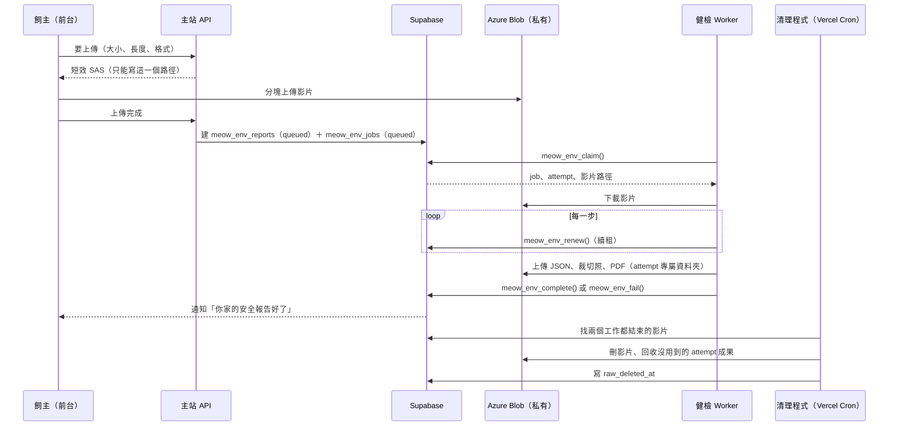

# 居家環境健檢 Worker 契約（主站 × WelfareLens）

| 項目 | 內容 |
|---|---|
| 文件版本 | v0.1 草稿（2026/11/06），待 Jerry 確認 |
| 對應 Issue | #241（整合）、#240（PDF 保存）、#242（影片清理）、#243（上傳限制）；上層 #62、#161 |
| 角色 | 主站（子哲＋Claude Code）：migration、RPC、API、上傳、清理程式。Worker（Jerry）：WelfareLens 領件、分析、上傳成果、回寫 |
| 相關決策 | 決策 006（大檔案放 Azure）、決策 007（居家影像產出後刪除、報告預設只有本人看得到） |

這份文件只定介面：資料表欄位、RPC 的參數與錯誤、檔案路徑、狀態怎麼轉。雙方照這份各自開工；欄位或名稱要改，先改這份再改程式。

---

## 1. 全貌



- 建立 3D 房間時：同一支影片同時排 `meow_room_jobs`（3D）和 `meow_env_jobs`（健檢）。
- 單獨居家安全檢測：只排 `meow_env_jobs`。
- **Worker 不刪影片**，只回報結果；影片一律由清理程式刪（#242）。

## 2. 限制（#243）

| 項目 | 值 |
|---|---|
| 格式 | mp4、mov（`video/mp4`、`video/quicktime`） |
| 長度 | 最長 180 秒，只收一段 |
| 大小 | 最大 300 MB |
| 誰檢查 | 前台上傳前（讀影片長度與大小）、主站 API 簽 SAS 前、Worker 下載後各檢查一次；超過就失敗、不重試 |

## 3. 資料表

### 3.1 `meow_env_jobs`（新增，只有 service role 讀寫）

| 欄位 | 型別 | 說明 |
|---|---|---|
| `id` | uuid PK | |
| `report_id` | uuid → `meow_env_reports.id`，on delete cascade | 一份報告同時只能有一筆 queued／running |
| `household_id` | uuid → `meow_households.id` | 來源喵戶；領件時驗證影片路徑屬於它 |
| `video_path` | text | Azure 路徑，見 §5 |
| `status` | text | `queued`／`running`／`done`／`failed` |
| `attempt` | int，預設 0 | 每次領件 +1；回寫時必須相同 |
| `max_attempts` | int，預設 3 | |
| `lease_until` | timestamptz | 租約到期時間，領件與續租時設成「現在＋10 分鐘」 |
| `worker_id` | text | Worker 自報的名稱（機器名＋程序 id） |
| `step` | text | 目前在做什麼，給後台看 |
| `error` | text | 最後一次失敗原因 |
| `retryable` | boolean | 最後一次失敗是否可以重試 |
| `queued_at`、`started_at`、`finished_at` | timestamptz | |

- RLS：只開給 MeowHQ（`virtual_assets` 模組）讀；會員看不到工作表，進度看報告的 `status`。
- 一筆工作「結束」＝`done`，或 `failed` 且不再重試（`attempt >= max_attempts` 或 `retryable = false`）。清理程式用這個判斷。

### 3.2 `meow_env_reports`（0017 已有，新增欄位）

| 欄位 | 說明 |
|---|---|
| `status` | `queued` → `running` → `ready`／`failed`（只由 RPC 改） |
| `summary`、`items`、`ready_at`、`error` | 0017 已有。`items` 格式見 §6 |
| `json_path`（新） | 完整分析結果 JSON 的 Azure 路徑 |
| `pdf_path`（新） | 圖文 PDF 的 Azure 路徑；**只含風險裁切照與文字，不放全景圖**（#240） |
| `attempt`（新） | 寫入成果的那次 attempt，方便清理程式分辨哪些成果要留 |

## 4. RPC（都是 `security definer`，只開給 service role）

Worker 用 service role key 呼叫 PostgREST：`POST /rest/v1/rpc/<函式>`。

### 4.1 `meow_env_claim(p_worker text) returns jsonb`

領最早的一筆工作，沒有就回傳 `null`。

- 可以領的：`status = 'queued'`，或 `status = 'running'` 但 `lease_until < now()`（上一個 Worker 當掉）。
- 用 `for update skip locked` 一次只讓一個 Worker 拿到。
- 領到時：`attempt + 1`、`status = 'running'`、`lease_until = now() + 10 分鐘`、`worker_id`、`started_at`；報告改 `running`。
- 租約過期而且 `attempt >= max_attempts` 的工作不會再被領，直接標 `failed`（`error = 'lease_expired'`，`retryable = false`），報告改 `failed` 並通知。
- 領件前驗證 `video_path` 開頭是 `homes/<household_id>/videos/`，不符就標 `failed`（`error = 'video_path_invalid'`）、不交給 Worker。

回傳：

```json
{ "job_id": "uuid", "attempt": 2, "report_id": "uuid", "household_id": "uuid",
  "video_path": "homes/<喵戶>/videos/<上傳 id>.mp4",
  "output_prefix": "homes/<喵戶>/reports/<報告>/a2/",
  "lease_until": "2026-11-06T10:10:00Z" }
```

### 4.2 `meow_env_renew(p_job uuid, p_attempt int, p_step text) returns timestamptz`

續租：`lease_until = now() + 10 分鐘`，順便更新 `step`。建議每做完一步、或最多每 3 分鐘呼叫一次。

### 4.3 `meow_env_complete(p_job uuid, p_attempt int, p_summary text, p_items jsonb, p_json_path text, p_pdf_path text) returns void`

一個 transaction 完成：

- 工作改 `done`、`finished_at`。
- 報告寫入 `summary`、`items`、`json_path`、`pdf_path`、`attempt`，改 `ready`、`ready_at`。
- 檢查 `items` 格式（§6）、路徑都在這次的 `output_prefix` 底下，不符就整筆不寫（`env_result_invalid`）。
- 通知飼主（§7）。
- **成果檔要先上傳完，才能呼叫這支**；呼叫成功之前，報告看不到任何成果。

### 4.4 `meow_env_fail(p_job uuid, p_attempt int, p_error text, p_retryable boolean) returns text`

- `p_retryable = true` 而且 `attempt < max_attempts`：工作改回 `queued`（下一次領件 attempt +1），回傳 `'requeued'`。
- 其他：工作改 `failed`、報告改 `failed`（`error` 寫給飼主看得懂的原因），通知飼主重拍，回傳 `'failed'`。
- 建議不可重試的錯誤：影片格式不對、超過長度或大小、看不出是室內。可重試：下載失敗、AI 服務逾時。

### 4.5 共同錯誤

| 錯誤代碼 | 什麼時候 | Worker 該做什麼 |
|---|---|---|
| `env_attempt_stale` | `p_attempt` 不是目前這次（租約過期後被別人接手） | 立刻停止這份工作，不要再上傳或回寫 |
| `env_job_not_running` | 工作已經結束或被改回 queued | 同上 |
| `env_result_invalid` | `items` 格式或路徑不符 | 修正後重試 complete；修不好就 fail（不可重試） |

## 5. Azure 路徑（私有容器，決策 006）

| 用途 | 路徑 | 誰寫 | 誰刪 |
|---|---|---|---|
| 居家影片 | `homes/<喵戶>/videos/<上傳 id>.<mp4/mov>` | 前台（主站簽的寫入 SAS） | 清理程式 |
| 一次 attempt 的成果 | `homes/<喵戶>/reports/<報告>/a<attempt>/` | Worker | 清理程式（沒被報告採用的 attempt） |
| 　分析結果 | `…/a<n>/result.json` | Worker | 跟報告一起刪 |
| 　風險裁切照 | `…/a<n>/crops/<item key>.jpg` | Worker | 跟報告一起刪 |
| 　圖文 PDF | `…/a<n>/report.pdf` | Worker | 跟報告一起刪 |

- Worker 在 VM 上用儲存帳戶金鑰（環境變數，不進 repo）；前台只拿主站簽的短效 SAS（寫入 15 分鐘、讀取 10 分鐘）。
- 前台看報告、PDF、裁切照：主站 API 檢查權限（本人，或報告已分享給這位中途）後簽讀取 SAS。資料庫只存路徑。

## 6. `items` 格式

```json
[{ "key": "window", "label": "窗戶沒有紗窗", "level": "high",
   "note": "貓可能從窗戶跳出或摔落。開窗前先裝好紗窗或防墜網。",
   "crop_path": "homes/<喵戶>/reports/<報告>/a2/crops/window.jpg" }]
```

- `key`：同一份報告內不重複，英數與底線，60 字內。
- `label`：繁體中文，20 字內。`level`：`high`／`medium`／`low`。`note`：繁體中文，200 字內，不給診斷或用藥建議。
- `crop_path`：可以沒有；有的話必須在這次 `output_prefix` 底下，而且是裁到只剩風險物品的照片（決策 007）。
- 最多 30 項；`summary` 2000 字內。

## 7. 通知（主站在 RPC 裡寫，Worker 不用處理）

| 時機 | 標題 | 連結 |
|---|---|---|
| 完成 | 你家的安全報告好了，看看有哪些地方要注意。 | `/homes/<喵戶>/safety` |
| 失敗（不再重試） | 安全檢測沒有完成，請照拍攝須知重新拍一次。 | `/homes/<喵戶>/safety` |

## 8. 影片清理（#242，主站負責）

清理程式每 10 分鐘：

1. 找 `raw_deleted_at` 是空的居家影片：它的 3D 工作（如果有）和健檢工作**兩筆都存在而且都結束**才刪；缺一筆就不刪。
2. 刪除後寫 `raw_deleted_at`；已經刪過的跳過（冪等）。
3. 補掃：失敗等重試的影片超過 **7 天**一律刪；上傳超過 24 小時沒有被任何房間或報告引用的影片刪除。
4. 報告 `ready` 之後，刪掉同一份報告底下、不是 `attempt` 那次的資料夾。

## 9. 請 Jerry 確認

1. 欄位與 RPC 名稱、參數是否夠用（特別是 `output_prefix` 由主站給，而不是 Worker 自己組）。
2. 10 分鐘租約、3 分鐘內續租一次，對 WelfareLens 的處理時間是否足夠；3 分鐘影片大約要跑多久。
3. 哪些錯誤歸「不可重試」。
4. `items` 欄位是否需要再加（例如信心分數、出現的時間點）。
5. Worker 的 Azure 存取：用儲存帳戶金鑰是否可以，或希望主站在領件時另外簽 SAS。

確認後，主站先出 migration（`meow_env_jobs`、報告新欄位、四支 RPC）與 PGlite 測試，在隔離環境驗證競爭領件與租約到期；Worker 照同一份契約串接。

## 10. 變更紀錄

| 日期 | 發起人 × 工具 | 變更 | PR |
|---|---|---|---|
| 2026-11-06 | 子哲 × Claude Code | v0.1 草稿，依 #240～#243 的決定 | — |
