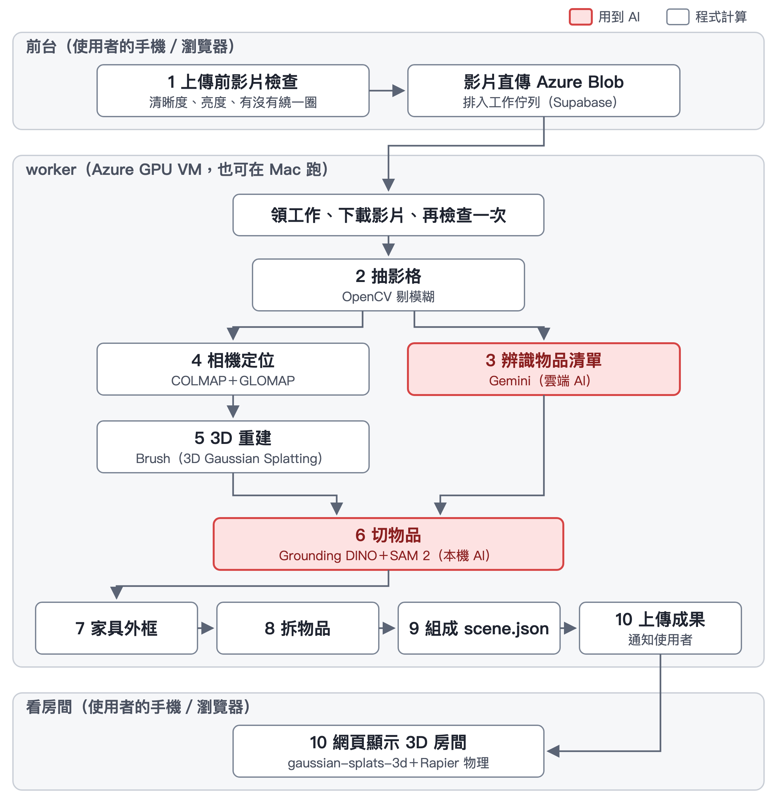
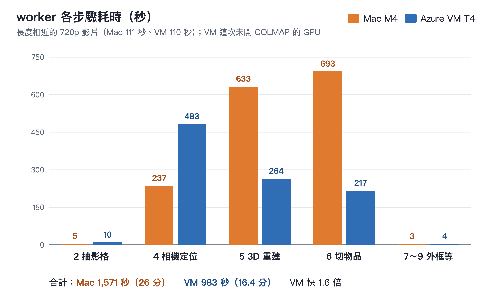

# 影片轉空間：技術與架構

> 房間轉換 worker（`workers/room-convert`）的流程、技術選擇、耗時與成本。安裝與執行方式見 [README](../README.md)。
> 整理：珮瑜（2026-11-20）
> 數字來源：2026-11-18 在 Azure VM（T4）實測 finaldemo（110 秒、720p）；2026-11-07 在 MacBook Air M4 實測 cleanroom（111 秒、720p）。兩支影片長度、解析度相同但內容不同，時間可以比大小，不是完全一樣的條件。

---

## 一、整體架構

### 流程圖

### 每個部分放在哪裡

| 部分 | 用什麼 | 放在哪裡 |
|---|---|---|
| 前台、上傳、看房間 | Next.js 網站 | Vercel |
| 原始影片 | 私有容器，瀏覽器拿短效網址直接上傳，不經過網站伺服器 | Azure Blob |
| 工作佇列 | 資料表 `meow_room_jobs`，worker 自己來領工作 | Supabase |
| 轉換程式（worker） | Python＋COLMAP、Brush、Grounding DINO、SAM 2 | Azure VM `nora-gpu-t4`（NVIDIA T4）；Mac 也能跑 |
| 轉換成果（3D 房間、物品、scene.json） | 約 12 MB | Supabase Storage `meow-room-models` |

- worker **不是網站直接呼叫**，而是自己去 Supabase 的佇列領工作。網站只要把工作排進去，不用等它跑完。
- 同一台 VM 也跑貓咪上色 worker，兩邊用 **GPU 檔案鎖**輪流領工作，不會同時搶 T4 的 16 GB 顯存。
- 同一支居家影片也會排一份「居家健檢」工作，由另一個 worker（WelfareLens）產生安全報告，不在這份範圍內。

---

## 二、10 個步驟總覽

| # | 步驟 | 工具 | AI？ | 用 CPU／GPU | VM 時間 |
|---|---|---|---|---|---|
| 1 | 上傳前影片檢查 | 瀏覽器 JavaScript | ❌ | 使用者手機 | — |
| 2 | 抽影格 | OpenCV | ❌ | CPU | 8 秒 |
| 3 | 辨識物品清單 | Gemini | ✅ 雲端 | — | 20 秒（同時跑） |
| 4 | 相機定位 | COLMAP＋GLOMAP | ❌ | CPU＋GPU | 354 秒 |
| 5 | 3D 重建 | Brush（3DGS） | ❌ | GPU | 256 秒 |
| 6 | 切物品 | Grounding DINO＋SAM 2 | ✅ 本機 | GPU | 187～226 秒 |
| 7 | 家具外框 | Python、OpenCV、Open3D | ❌ | CPU | 1.4 秒 |
| 8 | 拆物品 | Python、NumPy | ❌ | CPU | 1.6 秒 |
| 9 | 組成 scene.json | Open3D | ❌ | CPU | 1.2 秒 |
| 10 | 上傳成果、網頁顯示 | Supabase、gaussian-splats-3d＋Rapier | ❌ | 使用者手機 | 約 15 秒 |
| | **合計（worker）** | | | | **約 14 分鐘** |

---

## 三、各步驟說明

### 1. 上傳前影片檢查

**在做什麼**
- 先檢查格式：mp4／mov、最大 300 MB、最長 180 秒。
- 在使用者的瀏覽器裡，把影片抽幾張出來檢查，不用上傳、也不呼叫 AI。
- 檢查四件事：畫面清不清楚（Laplacian 清晰度）、夠不夠亮、有沒有在移動（前後畫面差異）、最後有沒有走回起點（頭尾畫面相似度）。
- 搭配「拍攝教練」：拍之前先用插圖和路線動畫教使用者怎麼拍。

### 2. 抽影格

**在做什麼**
- worker 下載影片後再檢查一次格式和長度，然後每秒抽 3 張照片，長邊最多 1920 像素。
- 用 OpenCV 算每張的清晰度，太模糊的丟掉。
- 110 秒的影片約留下 306 張。

### 3. 辨識物品清單（Gemini）

**在做什麼**
- 讓 Gemini 看幾張影格，從我們事先寫好的**物品目錄**裡，勾選這間房間有哪些東西。
- 目錄裡每樣物品的重量、材質、能不能被推倒都已經設好，AI 只負責判斷「有沒有」。
- 和相機定位同時跑，不佔總時間。忙線時會自動從 flash 改用 flash-lite（可能比較陽春，但不會失敗）。

### 4. 相機定位（COLMAP＋GLOMAP）

**在做什麼**：算出每張照片是在房間哪裡、朝哪個方向拍的。

| 順序 | 步驟 | 誰做 | 時間 |
|---|---|---|---|
| 1 | 找特徵點（桌角、海報邊） | COLMAP | 7 秒（GPU） |
| 2 | 前後照片配對，走回起點時接起來 | COLMAP | 167 秒 |
| 3 | 一次算出所有相機位置 | **GLOMAP** | 171 秒（只能用 CPU） |
| 4 | 校正廣角鏡頭的彎曲 | COLMAP | 7 秒 |

- COLMAP 原本是一張一張接，誤差會累積；GLOMAP 是全部一起算，比較快，繞一圈也比較不會歪。10/27 實測：63 秒 → 18 秒。
- VM 上原本忘了開 COLMAP 的 GPU，打開後整體快了 15%（見第五節）。

### 5. 3D 重建（Brush，3D Gaussian Splatting）

**在做什麼**：用幾十萬顆半透明的彩色小橢球，把房間「堆」出來。

1. 在稀疏點上放橢球（位置、大小、方向、顏色、透明度）。
2. 用某張照片的相機位置，把橢球「拍」成一張假照片。
3. 和真照片逐像素比對。
4. 把橢球往「更像真照片」的方向調一點。
5. 細節不夠就拆成更多顆，沒用的刪掉。
6. 重複 7,000 次，最後約 37.7 萬顆。

- **不是呼叫 AI**：沒有預先訓練好的模型，每間房間都從零擬合。
- 選 Brush 而不是 OpenSplat：Brush 在 Mac 和 VM 都能用 GPU；OpenSplat 在我們的 Mac 上缺 Xcode，只能用 CPU（42.5 分鐘 vs 8.9 分鐘）。

### 6. 切物品（Grounding DINO＋SAM 2）

**在做什麼**：在幾十萬顆橢球裡，標出哪些屬於床、杯子、背包。

1. 每 4 張影格取 1 張。
2. **Grounding DINO** 聽懂文字（例如「a bed」），在照片上框出床。
3. **SAM 2** 沿著邊緣描出精確輪廓。
4. 把每顆橢球投影到照片上，落在輪廓裡的得到一票。
5. 從很多角度都被認成床的才算床，只被投到一兩次的當成誤判丟掉。
6. 每樣物品重複一次。

- 兩個都是開源、預先訓練好的 AI 模型（Grounding DINO tiny、SAM 2.1 small），在本機或 VM 上跑，不用付費。
- 時間約等於「影格數 × 物品數」。

### 7. 家具外框

**在做什麼**：把床、書桌這類大型家具，整理成貓能理解的「方塊」。
- **去掉切歪的部分**：只留下點最密、最連在一起的那一塊，旁邊黏進來的雜點（例如床邊的牆）會被切掉。
- **貼齊地板、對齊牆**：讓外框站在地上，並轉到和牆一樣的角度（finaldemo 的床轉了 −34°）。
- **算出表面高度**：床墊、桌面有多高，貓才知道要跳多高（finaldemo 的床面 0.44 公尺）。
- **找出凸起**：床上的棉被、枕頭堆，另外分成幾塊高一點的方塊，貓不會穿過去。

### 8. 拆物品

**在做什麼**：把可以被推倒的小東西，從房間裡挖出來另存。
- 只挑物品目錄裡標成「可移動」、而且長邊在 40 公分以內的東西，例如杯子、瓶子、鞋子、背包。超過 40 公分的通常是好幾樣黏在一起，先略過。
- 把它的點從房間拿掉，存成**挖空的房間**（`room_cut.splat`）。
- 物品本身另存一份，原點設在底部中心，才能整個移動和旋轉。

### 9. 組成 scene.json

**在做什麼**：把前面所有結果整理成**一份說明書**，網站和貓只讀這一份。
- **房間**：地板在哪、牆在哪、房間多大、座標朝哪個方向。
- **檔案**：完整的房間、挖空的房間、每個可移動物品的檔案在哪。
- **每個物品**：名稱、位置、大小、表面高度，以及從物品目錄帶過來的互動屬性和物理性質（重量、材質、能不能被推）。
- **碰撞形狀**：用物品的點算出一個包住它的外殼，最多 48 個頂點，讓物理引擎算得動。
- 目錄裡沒有的物品，一律當成固定不動，避免亂動。

### 10. 上傳成果、網頁顯示

**在做什麼**
- worker 把成果（約 12 MB：縮圖、3D 房間、挖空的房間、物品、scene.json）上傳到 Supabase Storage，通知使用者「房間好了」。
- 原始影片 worker 不會刪；規格書規劃由主站的清理程式定期刪除，**目前還沒實作**。
- 網頁用 gaussian-splats-3d（基於 Three.js）顯示 3D 房間，Rapier 負責物理碰撞。電腦用 WASD 走動，手機用搖桿，有前、後、左、右、上五個固定視角。

---

## 四、耗時：Mac 和 VM 比較

| 步驟 | Mac M4 | VM T4（未開 GPU=1） | VM 比 Mac |
|---|---|---|---|
| 2 抽影格 | 5 秒 | 10 秒 | 慢 2 倍 |
| 4 相機定位 | 237 秒 | **483 秒** | **慢 2 倍** |
| 5 3D 重建 | 633 秒 | 264 秒 | 快 2.4 倍 |
| 6 切物品 | 693 秒 | 217 秒 | 快 3.2 倍 |
| 7～9 外框／拆物品／scene | 3 秒 | 4 秒 | 差不多 |
| **合計** | **1,571 秒（26 分）** | **983 秒（16.4 分）** | 快 1.6 倍 |

- 第 3 步 Gemini 和第 4、5 步同時跑，不佔總時間（Mac 11 秒、VM 25 秒）。
- VM 的 GPU 比 Mac 強，所以 3D 重建和切物品快很多；但 VM 只有 4 核 CPU，相機定位反而比 Mac 慢。

---

## 五、CPU 和 GPU：一次免費的加速

### VM 每一步用了多少 GPU、CPU（未開 GPU=1）

每 5 秒記一次的平均值（`nvidia-smi`、`vmstat`）：

| 步驟 | GPU 使用率 | 顯存最高 | GPU 耗電 | CPU 使用率（4 核） |
|---|---|---|---|---|
| 2 抽影格 | 0% | — | 10 W（待機） | 66% |
| 4 相機定位：找特徵 | **0%** | — | 10 W | **97%** |
| 4 相機定位：配對 | **0%** | — | 10 W | 83% |
| 4 相機定位：GLOMAP | **0%** | — | 10 W | 67% |
| 5 3D 重建 Brush | 87% | 1.7 GB | 63 W | 14% |
| 6 切物品 DINO＋SAM | 72% | 2.7 GB | 54 W | 31% |
| 10 上傳成果 | 0% | — | 10 W | 約 15 秒後歸零 |

**發現**：VM 上的 COLMAP 是 CUDA 版，可以用 GPU 找特徵和配對，但 worker 沒有打開 `GPU=1`，所以相機定位那 8 分鐘全靠 4 核 CPU。整個轉換 983 秒裡，GPU 真正在工作的只有 481 秒（49%）。

### 打開 COLMAP 的 GPU 之後

同一支 finaldemo、同一台 T4：

| 步驟 | 沒開 | GPU=1 第一次 | GPU=1 第二次 |
|---|---|---|---|
| 相機定位：找特徵 | 63.5 秒 | **7.0 秒** | **7.0 秒** |
| 相機定位：配對 | 240.3 秒 | **166.5 秒** | **165.7 秒** |
| 相機定位：GLOMAP | 171.0 秒 | 171.3 秒 | 184.4 秒 |
| **相機定位合計** | **483 秒** | **354 秒** | **366 秒** |
| 3D 重建 | 264 秒 | 256 秒 | 258 秒 |
| 切物品 | 217 秒 | 187 秒 | 226 秒 |
| **總計** | **983 秒（16.4 分）** | **810 秒（13.5 分）** | **864 秒（14.4 分）** |

- 平均快約 **15%**（16.4 → 14 分），成果一樣（306 張影格、約 37.7 萬顆高斯）。
- 兩次差 54 秒，主要在切物品和 GLOMAP，屬於正常浮動。

### 哪些步驟用得到 GPU

| 類型 | 例子 | 說明 |
|---|---|---|
| 沒有 GPU 版本 | GLOMAP、外框、scene.json | 永遠用 CPU |
| 安裝時就決定 | OpenSplat、COLMAP | 裝錯版本就只能用 CPU |
| 執行時自動偵測 | Brush、切物品 | 有 GPU 就自動用 |
| 支援但預設關著 | COLMAP 的 GPU | 要手動打開（`GPU=1`） |

---

## 六、成本

### 一間房間要多少錢

| | Mac M4 | Azure VM（NC4as_T4_v3） |
|---|---|---|
| 一間房間的時間 | 26 分鐘 | 約 14 分鐘 |
| 機器費 | 0 | 約 NT$6（US$0.736／小時 × 約 0.25 小時） |
| Gemini | < US$0.01 | < US$0.01 |

### 真正的成本關鍵：沒工作時有沒有關機

| 項目 | 價格（Azure 官方，東南亞區） |
|---|---|
| VM 開機 | US$0.736／小時（約 NT$23.9） |
| VM 開一整天沒事做 | 約 NT$573 |
| 磁碟 128 GB（關機也收） | US$9.6／月 |
| 固定 IP（關機也收） | 約 US$3～4／月 |

### 換更強的機器划算嗎（價格，尚未實測）

| 機型 | GPU | CPU | 每小時 |
|---|---|---|---|
| **NC4as_T4_v3（現在）** | T4 | 4 核 | US$0.736 |
| NC8as_T4_v3 | T4 | 8 核 | US$1.052 |
| NC16as_T4_v3 | T4 | 16 核 | US$1.685 |
| NC24ads_A100_v4 | A100 80 GB | 24 核 | US$4.775 |

---

## 七、結論與下一步

1. **COLMAP 的 GPU 要預設打開**：不用加錢就快 15%。現在要手動加 `GPU=1`，之後改成偵測到 NVIDIA GPU 時自動開。
2. **要再加速，加 CPU 而不是換 GPU**：最慢的 GLOMAP 只吃 CPU；NC8as／NC16as 是同一張 T4、多一倍到四倍的 CPU。
3. **換 A100 不划算**：每小時貴 6.5 倍，只加速 3D 重建和切物品。
4. **省最多的是關機**：沒工作就關，或改成有工作才開機。

---

## 八、備註

- **用到 AI 的只有兩步**：第 3 步 Gemini（雲端、付費但極便宜）、第 6 步 Grounding DINO＋SAM 2（本機開源模型、免費）。第 5 步 3DGS 是最佳化方法，不是呼叫 AI。
- Gemini 費用是估計值，沒有查帳單；Azure 價格來自官方 Retail Prices API，固定 IP 用 Basic 的價格估。
- 第 1 步手機上的檢查時間沒有量過。
- 「原始影片處理完就刪除」目前**還沒實作**（第 10 步）。
- COLMAP GPU 自動偵測的改動還在本機分支，還沒合併；現在 VM 上要手動加 `GPU=1`。
- 實驗環境：VM `Standard_NC4as_T4_v3`（T4 16 GB、4 核 CPU、27 GB 記憶體、Ubuntu 24.04、COLMAP 4.2.1 CUDA 版）；Mac 是 MacBook Air M4（10 核 CPU、16 GB）。
